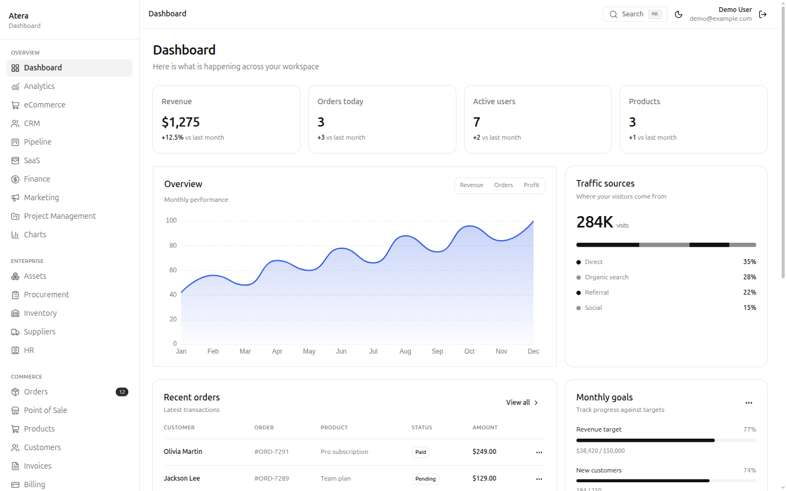
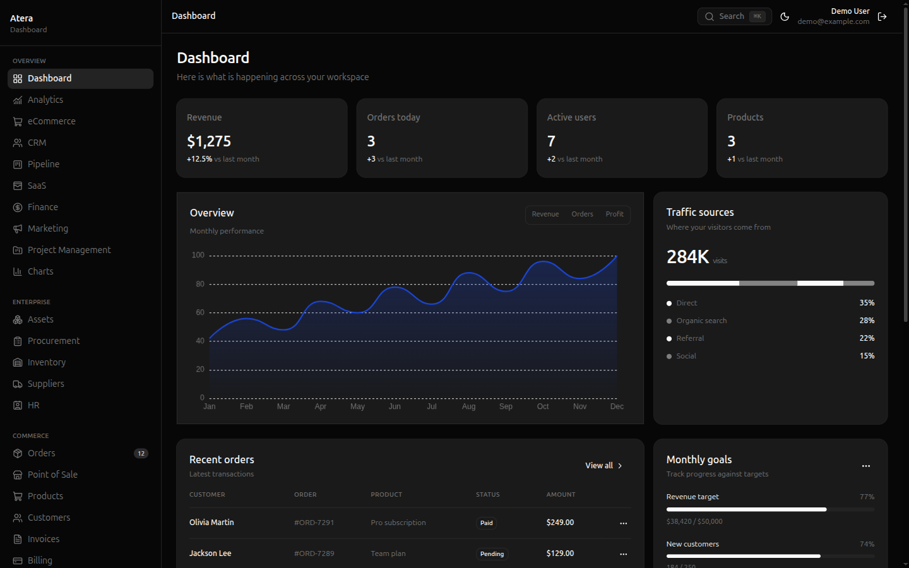
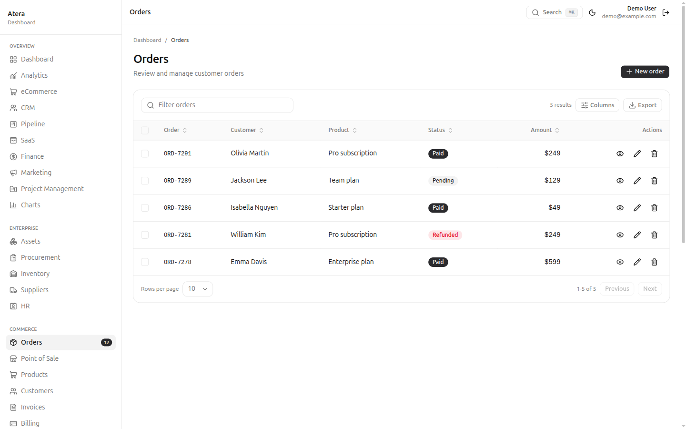
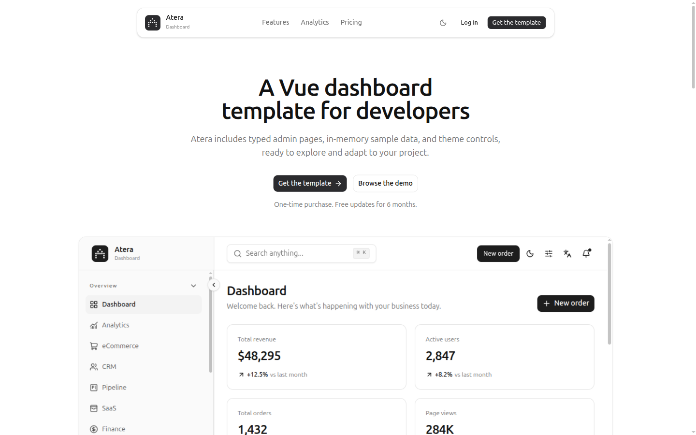

# Atera (Vue)

[](https://vite.dev)
[](https://www.typescriptlang.org)
[](https://vite.dev)
[](https://tailwindcss.com)
[](https://bun.sh)

A Vue 3 admin dashboard template built with Vite, TypeScript, Tailwind CSS v4 and shadcn-vue. Routes, UI primitives, typed sample data and a thin service layer ship together, so every page opens on real rows instead of an empty shell.

## Screenshots

| Dashboard | Dark mode |
|:---:|:---:|
|  |  |

| Orders | Landing |
|:---:|:---:|
|  |  |

## Stack

- Vue 3.5 + TypeScript, Vite 8
- Tailwind CSS v4 (tokens in `src/app.css`, no JS config)
- shadcn-vue (reka-ui) primitives in `src/components/ui/`
- vue-router 4, Pinia, vue-i18n (en/de/fr)

## Quick start

```bash
bun install
bun run dev      # http://localhost:5173
bun run build    # vue-tsc + vite build
bun run preview
```

Demo login: `demo@example.com` / `AteraDemo2026!`

## Structure

```
src/
  components/
    ui/        shadcn-vue primitives (82 files, 17 groups)
    charts/    ECharts wrappers
    dashboard/ dashboard widgets
    shared/    DataTable, PageHeader, StatCard, EmptyState, ConfirmDialog, RecordDialog, Toaster
  composables/ useToast, useChartColors
  i18n/        en / de / fr messages
  layouts/     AuthLayout, ProtectedLayout (sidebar + header shell)
  lib/
    data/      typed in-memory mock modules (21 domains)
    auth.ts    localStorage session
    navigation.ts
  pages/       57 route screens (dashboard, ERP, commerce, apps, settings, auth, legal, errors)
  router/      routes + auth guard
  services/    thin typed service per domain (backend swap point)
  stores/      auth, preferences (appearance, color, density, container, language)
```

## What's included

- 64 routes across 5 navigation groups: overview (dashboard, analytics, ecommerce, CRM, pipeline, SaaS, finance, marketing, project management, charts), enterprise (assets, procurement, inventory, suppliers, HR), commerce (orders, POS, products, customers, invoices, billing, pricing), apps (mail, chat, files, kanban, calendar, wizard, forms, AI chat, editor, maps, widgets), system (profile, users, notifications, settings, support, search)
- Auth flow with a demo account, plus forgot/reset password, two-factor, verify email and lock screen
- Legal, 404/403/500, coming soon and maintenance pages
- Full CRUD on orders, products, users, customers, invoices, assets and suppliers with validated dialogs and toasts
- Searchable, sortable, paginated data table with column visibility and CSV export
- Global search (Ctrl/⌘ + K), page transitions and scroll restoration

## Data flow

Pages call a service; the service delegates to a mock data module.

```
page → src/services/* → src/lib/data/* → (replace with REST / GraphQL)
```

Swap one service file per domain to connect a backend. Pages do not change.

## Theming

- Design tokens live in `src/app.css` (`@theme` block, oklch variables)
- Dark mode via the `.dark` class
- Five color presets: `data-color` = zinc | blue | violet | rose | orange
- Density: `data-density` = compact | comfortable | spacious
- Container: `data-container` = fluid | boxed

Preferences persist in `localStorage` (`atera_preferences`).

## Docs page

Run the app and open `/docs` for architecture, data layer, UI components, theming, i18n and a step-by-step "adding a page" guide.
